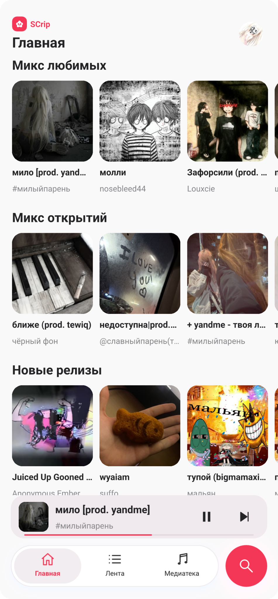
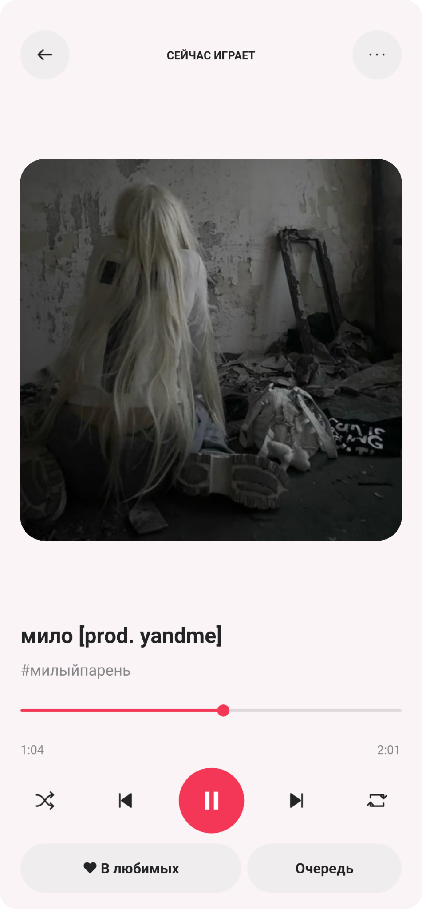
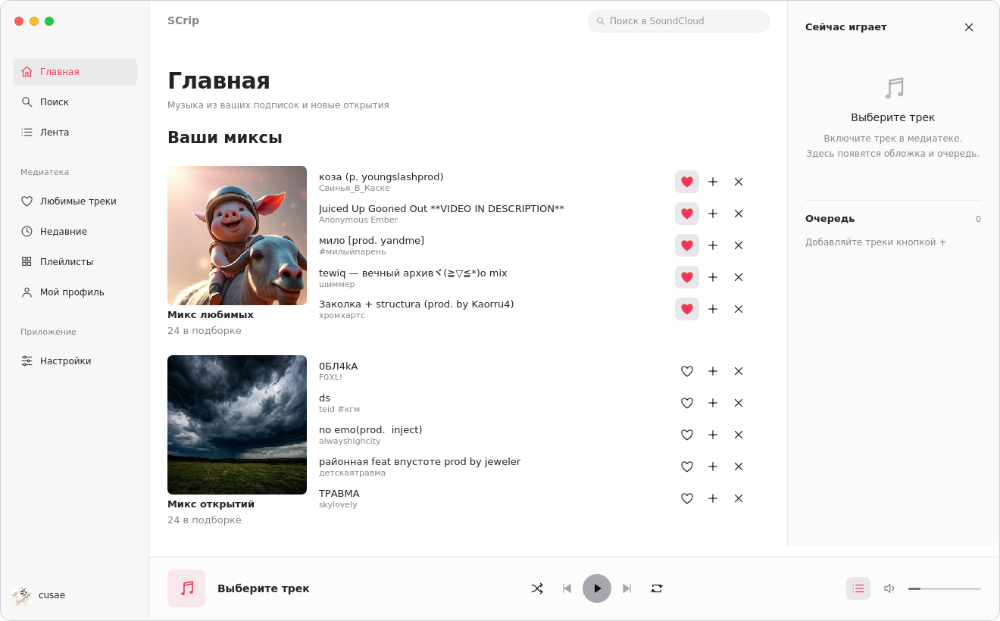
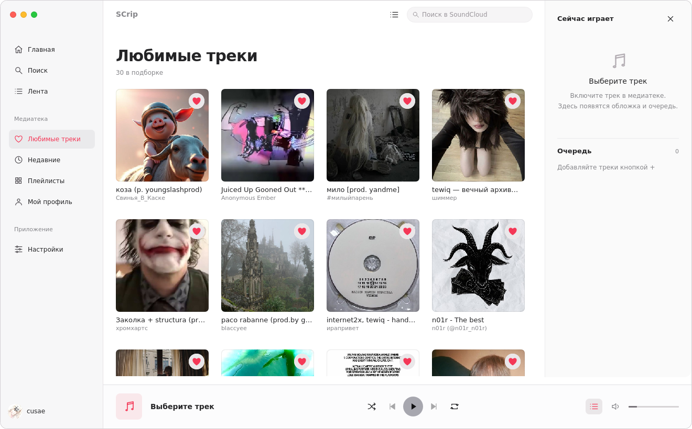

<p align="center">
  
</p>

<h1 align="center">SCrip</h1>

<p align="center">SCrip — плеер для Windows, Linux и Android, который работает через официальный API SoundCloud.<br>Ваши лайки, свежие релизы и станции любимых исполнителей — в отдельном приложении.</p>

<p align="center">
  <a href="https://github.com/sykia/SCrip/releases/download/v1.3.0/SCrip-1.3.0-Windows-x64.exe"></a>
  <a href="https://github.com/sykia/SCrip/releases/download/v1.3.0/SCrip-1.3.0-debian13-amd64.deb"></a>
  <a href="https://github.com/sykia/SCrip/releases/download/v1.3.0/scrip-1.3.0-1-x86_64.pkg.tar.zst"></a>
  <a href="https://github.com/sykia/SCrip/releases/download/v1.3.0/SCrip-1.3.0-Android-universal.apk"></a>
</p>

## Что нового в 1.3.0

Мобильная версия с нижней навигацией, мини-плеером и большим экраном текущего трека. Музыка играет в фоне; переключать треки можно из уведомления, с экрана блокировки и через виджет. Следующий трек подготавливается заранее.

<p align="center">
  
  
</p>

[Все изменения с 1.0.0](CHANGELOG.md) · [Скачать релиз 1.3.0](https://github.com/sykia/SCrip/releases/tag/v1.3.0)

## Android

Установите [универсальный APK 1.3.0](https://github.com/sykia/SCrip/releases/download/v1.3.0/SCrip-1.3.0-Android-universal.apk) и разрешите установку из выбранного браузера или файлового менеджера.

На телефоне доступны вход через системный браузер, любимые треки, поиск и управление воспроизведением. Поддерживаются Android 9 и новее, ARM64, ARMv7 и x86-64. Для сборки под ARM64 нужны Qt 6.10.1 для Android и настольный комплект той же версии, Qt Multimedia, JDK 17, Android SDK и NDK r27c (27.2.12479018). Для HTTPS также нужен [android_openssl](https://github.com/KDAB/android_openssl), проверенный коммит `b71f1470962019bd89534a2919f5925f93bc5779`. Укажите путь к нему в `SCRIP_ANDROID_OPENSSL_ROOT`. Укажите пути к комплектам в `QT_ANDROID` и `QT_HOST_PATH`, а пути к инструментам Android — в `ANDROID_SDK_ROOT`, `ANDROID_NDK_ROOT` и `JAVA_HOME`.

```sh
"$QT_ANDROID/bin/qt-cmake" -S . -B build/android -G Ninja -DCMAKE_BUILD_TYPE=Debug -DQT_HOST_PATH="$QT_HOST_PATH"
cmake --build build/android --target apk
adb install -r build/android/android-build/build/outputs/apk/debug/android-build-debug.apk
```

## Что послушать сегодня

Войдите в свой аккаунт и включите персональный микс с главной. Справа от обложки виден его треклист: можно сразу выбрать песню, поставить лайк или сохранить находку в плейлист. Хочется чего-то нового? Запустите станцию исполнителя, и SCrip подберёт похожие треки.



## Любимые треки и очередь

Листайте избранное по обложкам и нажимайте на имя автора, чтобы открыть его профиль. В правой колонке можно перетащить трек выше или выбрать «Играть следующим». Когда пора вернуться к работе, сверните плеер в трей — переключать музыку и ставить лайки можно прямо из меню значка.



## Лицензия и права

Собственный код SCrip распространяется по [SCrip Proprietary License 1.0](LICENSE): пользоваться приложением бесплатно, изучать код и собирать его для собственного использования можно. Публикация изменённых сборок, использование кода в других продуктах и распространение копий требуют письменного разрешения правообладателя, кроме прямо предусмотренных лицензией и законом случаев. Это проект с доступным исходным кодом, а не open source.

Лицензии сторонних компонентов сохраняют силу; см. [уведомления и состояние проверки зависимостей](THIRD_PARTY_NOTICES.md). В Windows-пакете 1.3.0 обнаружен FFmpeg GPLv3+: добавление LICENSE не устраняет требования GPL; для проприетарного распространения нужна замена этой сборки и повторная проверка зависимостей.

SCrip — независимый клиент, не официальный продукт SoundCloud. SoundCloud, музыка, обложки и другие материалы принадлежат соответствующим правообладателям. Лицензия SCrip не предоставляет прав на эти материалы и не заменяет разрешений по [условиям SoundCloud API](https://developers.soundcloud.com/docs/api/terms-of-use).
